# 校园二手交易系统实验二报告

学号 241220070　姓名 贾一帆　日期 2026年11月5日

阶段稿　本次完成四种 UML 图 八模块 UI 及 AI 辅助设计记录

## 一 项目与主要功能

本项目面向校内师生，支持闲置商品售卖、免费赠送、预约交易、付款交付和售后处理。管理员负责商品审核、代交权限分配与举报处理。本阶段采用 Java 组织类结构和业务模块，用状态图说明生命周期、时序图说明交易协作。

## 二 类图设计

### 核心类的职责

| 类 | 核心内容与职责 |
|---|---|
| 交易平台 CampusMarket | 用 Map 按编号管理用户、商品、预约与订单，提供统一查询入口。 |
| 用户 User | 保存角色、发布商品、买卖双方预约及代交任务，按身份查询售后与举报。 |
| 商品 Product | 保存发布者、价格、数量、交易类型和售后声明，关联预约与举报。 |
| 预约 Reservation | 连接买家与商品，记录数量、卖家答复和确认期限，对应一笔订单。 |
| 订单 Order | 保存交易双方、商品及成交快照，关联支付、代交、售后和举报。 |
| 支付记录 Payment | 抽象付款金额、状态和原订单，作为两种付款记录的共同父类。 |
| 线上支付 OnlinePayment | 记录渠道结果，支持收货后结算与符合条件的原路退款。 |
| 线下付款 OfflinePayment | 由订单卖家确认收款，记录确认人及时间。 |
| 代交任务 DeliveryTask | 关联订单、代交人和分配管理员，记录取件、交件与失败。 |
| 售后申请 AfterSaleRequest | 关联原订单、申请买家和介入管理员，记录退货数量及处理状态。 |
| 举报 Report | 关联举报人、处理管理员及唯一目标，目标为商品或订单。 |

### 类之间的关系与设计原因

空心菱形表示聚合，实线箭头表示可导航关联，空心三角表示继承。连线上的“-成员名”与数量直接表达对象或集合成员，类框不再重复列出。用户通过角色集合兼任多种身份，各处集合引用同一条业务记录。

成功预约与订单一一对应。订单的成交快照固化商品名、单价、数量、总额、交易类型和售后声明，商品后续修改不影响原交易。售罄商品保留历史，在售商品通过状态与剩余数量筛选。

支付记录通过继承区分线上与线下流程；代交、售后通过关联明确执行人、申请人和处理人。商品与订单各有举报集合，但一条举报只能指向一个目标。具有角色权限后，还须检查商品归属、订单参与人或任务分配关系。

<!-- figure-page -->
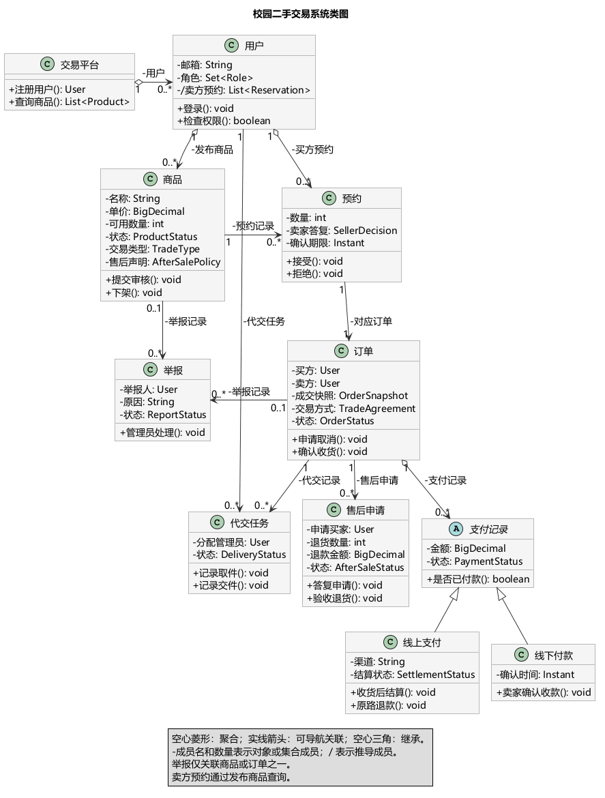

<!-- page-break -->
## 三 组件图设计

后端按职责划分为八个业务模块，前端、数据库、邮箱及支付渠道置于主体外提供支撑。预约负责申请与协商，订单管理交易生命周期；代交执行交付，售后处理退货与争议。

预约依赖商品库存并建立订单；订单核对付款，收货后发起结算；代交同步交付进度；售后验收后申请退款；平台管理执行违规限制。虚线箭头表示主要依赖，跨模块更新须保证事务一致性。

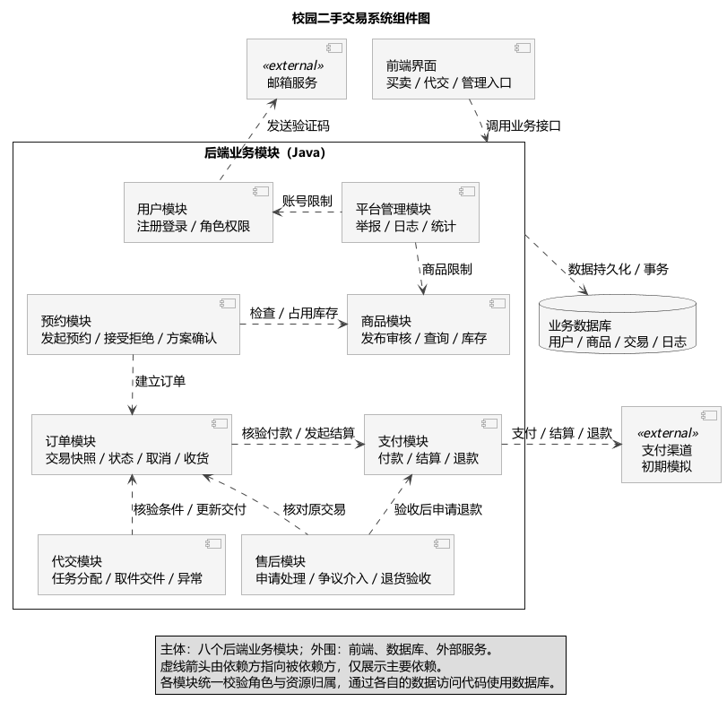

## 四 状态图设计

### 订单主流程

待确认表示等待卖家接受及双方确认方案，卖家仅接受预约时仍保持此状态。售卖或赠送在商品发布时确定并写入订单快照；售卖协商付款与交付方式，赠送只协商交付方式。

双方确认后，售卖且线上付款进入待付款，付清后进入待交付；线下售卖和赠送直接进入待交付。代交取件进入交付中，满足相应付款、交件及买方收货条件后已完成；符合取消规则时已取消。售后进度另行记录，不回退已完成订单。

<!-- figure-page -->
<!-- figure-width: 9.2 -->
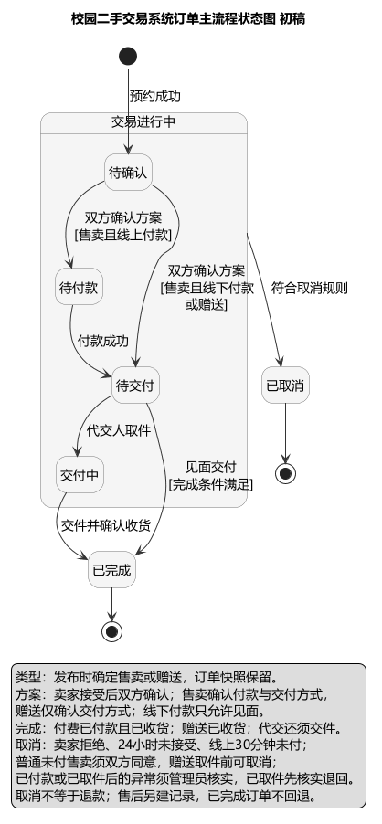

### 售后申请

售后申请关联原订单并独立流转，原订单保持已完成。各状态含义如下。

待卖方处理表示等待答复；卖方已拒绝保留卖方的否定意见，买方仍可申请介入；管理员核查表示依据双方证据处理争议；申请被驳回表示管理员拒绝本次申请。

待退货表示已获同意、等待买方退回；待验收表示商品已退回、等待核验；退款处理中表示验收通过、等待资金处理；已退款表示实际退款成功，线下须买方确认收到。

<!-- figure-page -->
<!-- figure-width: 8 -->
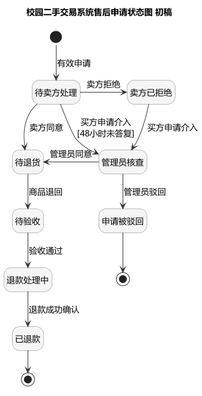

普通售后须订单原声明支持，买方在收货后168小时内申请，累计退货数量与金额不能超出原交易。卖方拒绝或48小时未答复后，买方可申请管理员介入，批准后仍须退货验收。已结算款项先由卖方返还，资金未到位或退款失败仍在处理中；退回商品须重新审核才能上架。

## 五 时序图设计

时序图展示售卖商品线上付款、见面交付的正常流程，由买家、卖家、平台后端、数据库和支付渠道协作。预约确认阶段占用库存、创建预约与订单快照，并确认方案；付款交付阶段核验有效付款后交货；收货结算阶段完成订单，再向卖家转交货款。

图中 critical 框表示预约关联操作须整体成功或失败，防止库存与订单不一致。支付成功只记录待结算，买家确认收货后才执行货款转交；结算失败保留待处理，重试不得重复转款。

异常规则在文字中补充：付款失败未超时可重试；进入待付款满30分钟仍未付款，系统自动取消并仅释放对应占用一次；取消后的迟到付款进入退款处理，不恢复订单。图面保留三个主要阶段，便于连续阅读。

<!-- figure-page -->
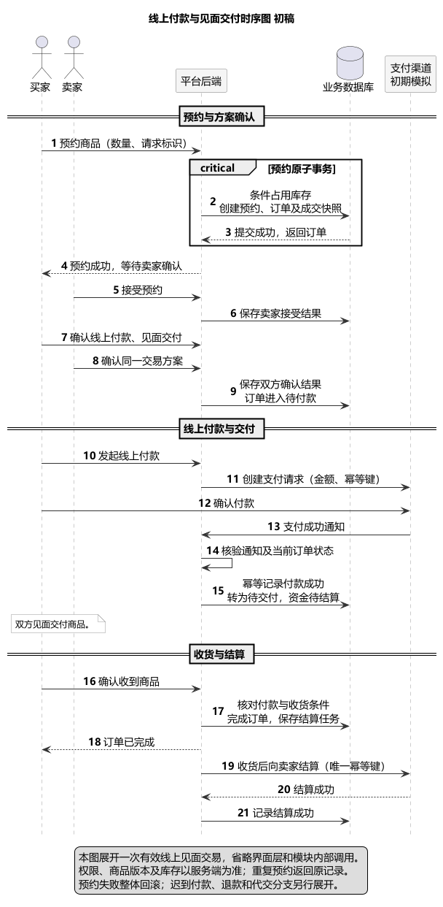

<!-- ui-page -->
## 六 UI 界面设计

界面采用桌面网页布局，以白底黑字突出信息和操作，商品图保留彩色。报告选取10张主要界面覆盖八个业务模块，其余状态变体及过程稿另行保存。以下均为静态设计，实际操作仍须核验权限、资源归属和最新状态。

### 用户模块 学校邮箱登录

学校邮箱验证码用于注册与登录，验证后才可发布和预约。验证码5分钟有效，发送间隔60秒，输错5次失效；代交与管理权限由平台授权。

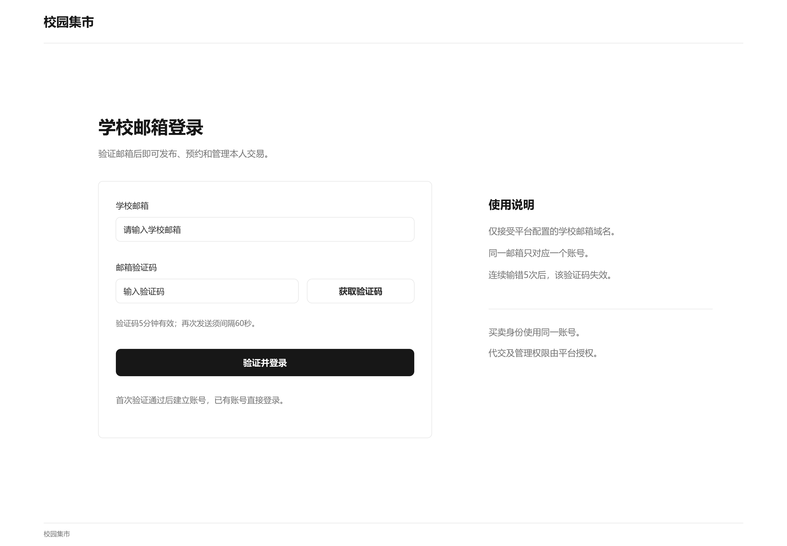

<!-- ui-page -->
### 商品模块 商品浏览

商品列表支持关键词、分类、价格及交易方式组合筛选。卡片仅保留图片、名称、价格、发布者和可用库存，便于比较；新旧与磨损信息放在详情中。

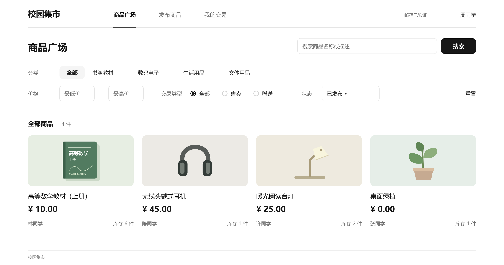

<!-- ui-page -->
### 商品模块 发布商品

卖方填写商品、数量、图片及使用和磨损说明，选择全新闲置或二手。售卖须设置正单价并明确售后声明，赠送金额为0；保存草稿后提交审核，通过才公开。

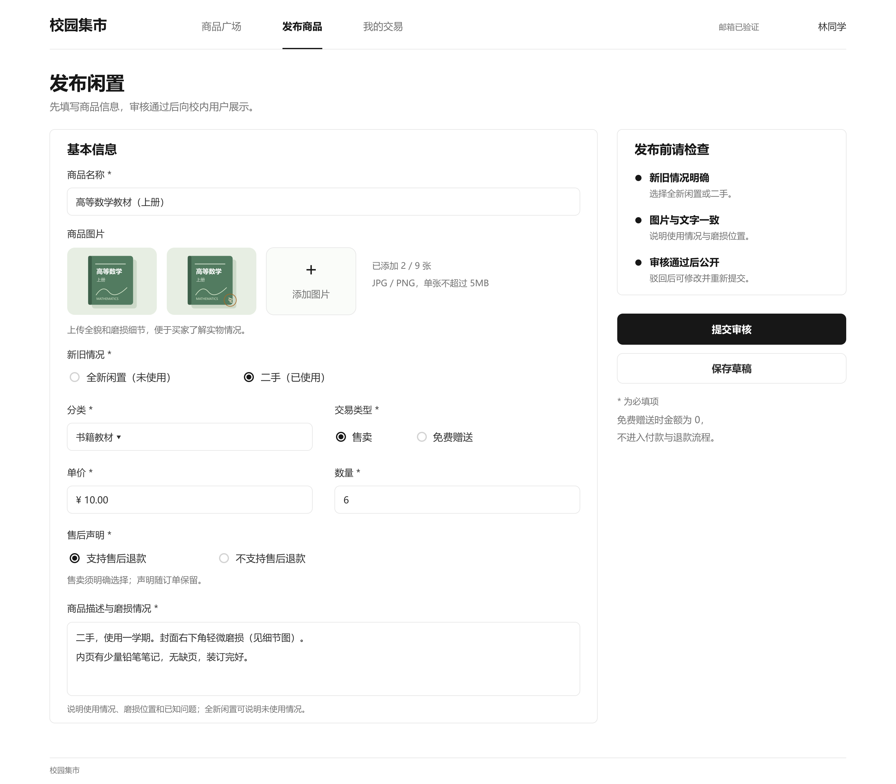

<!-- ui-page -->
### 预约模块 商品详情与预约

详情展示新旧情况、磨损图片、描述和售后声明。买方选择数量并核对金额，只能预约他人已发布且库存充足的商品；提交时重新检查价格与库存，重复请求不重复占用。

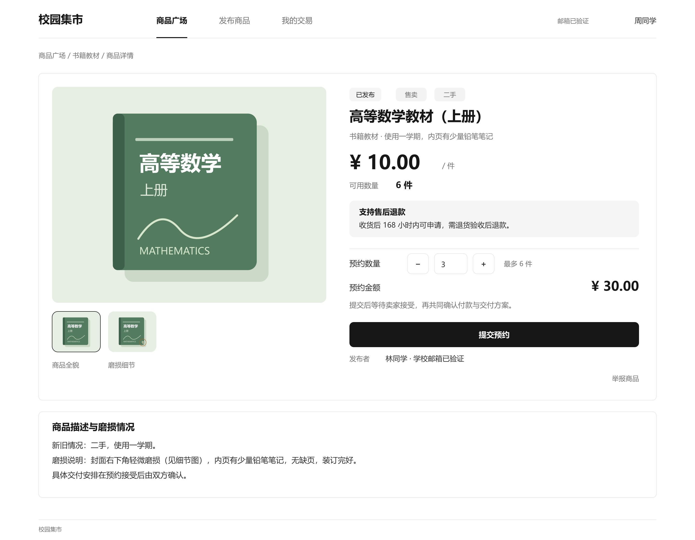

<!-- ui-page -->
### 订单模块 个人工作台

同一账号分设买方预约与待确认、卖方待答复入口，先查看列表再进入详情。买卖双方都能查询待确认订单和收到的取消申请，按本人在该订单中的身份处理。

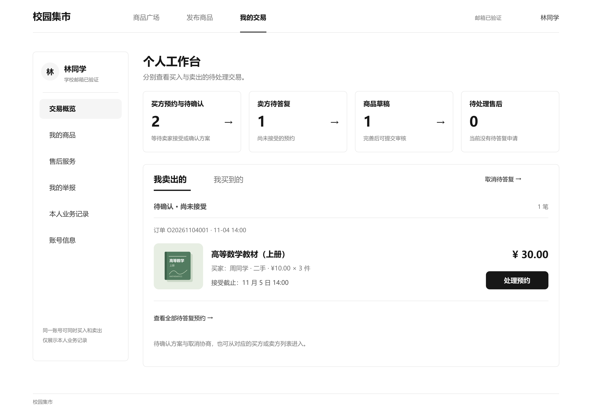

<!-- ui-page -->
### 订单模块 交易方案确认

卖方接受预约后，双方仍须确认同一付款与交付方案；方案修改会清除旧确认。线上售卖可见面或代交，线下只可见面，赠送无需付款。未付款售卖的普通取消须对方同意，单方申请不释放占用或暂停期限。

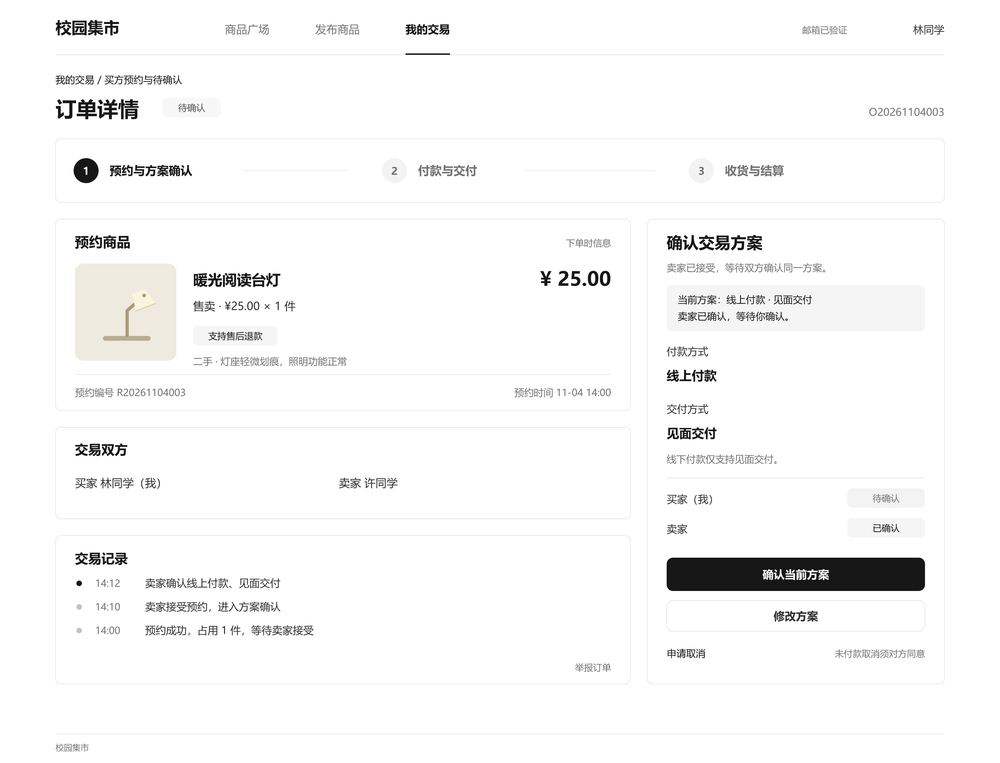

<!-- ui-page -->
### 支付模块 模拟线上付款

付款页集中显示商品金额、截止时间和模拟标识。进入待付款满30分钟仍未付款则自动取消，失败未超时可重试；迟到付款原路退款。付款与结算分开，买方收货后才向卖方结算，失败保留待处理。

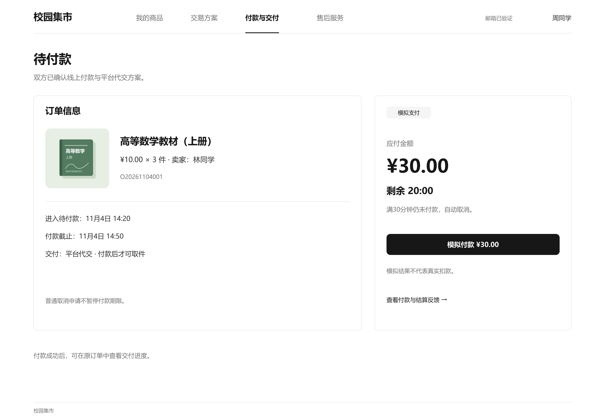

<!-- ui-page -->
### 代交模块 任务处理

官方代交人只处理分配给本人的任务，核对商品、数量和交接地点后记录取件，再记录交件。线上未付款不能取件，代交交件后仍须买方确认收到；改约须双方确认，取件后异常由管理员核实处理。

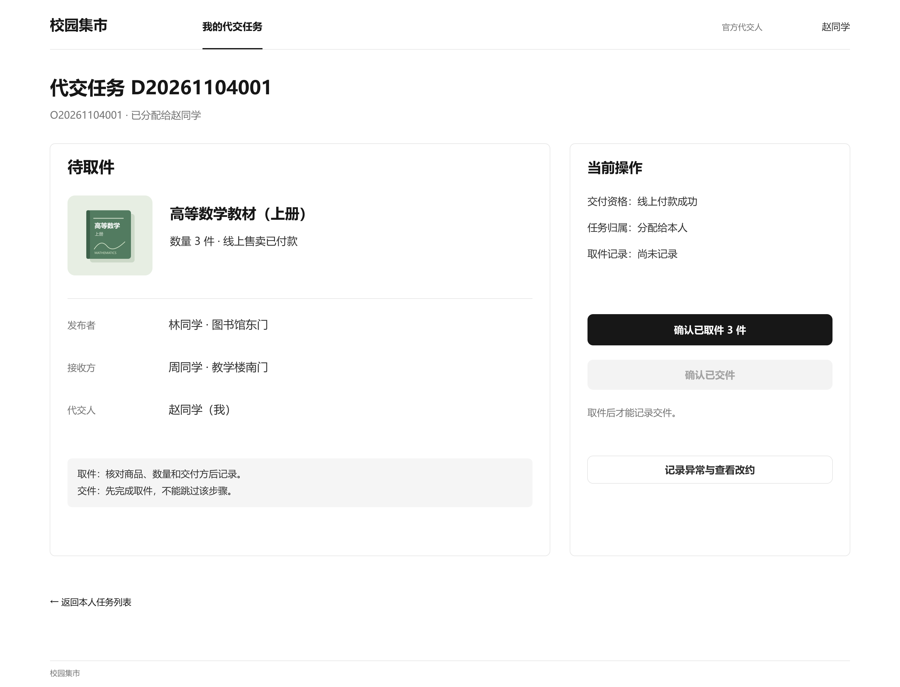

<!-- ui-page -->
### 售后模块 部分退货申请

买方按原订单声明在收货后168小时内申请，填写数量、原因与证据。示例原购3件共30元，申请退1件、退款10元。卖方48小时内答复，拒绝或超时后由买方申请介入；获准仍须验收，资金到位后退款，退回商品不自动上架。

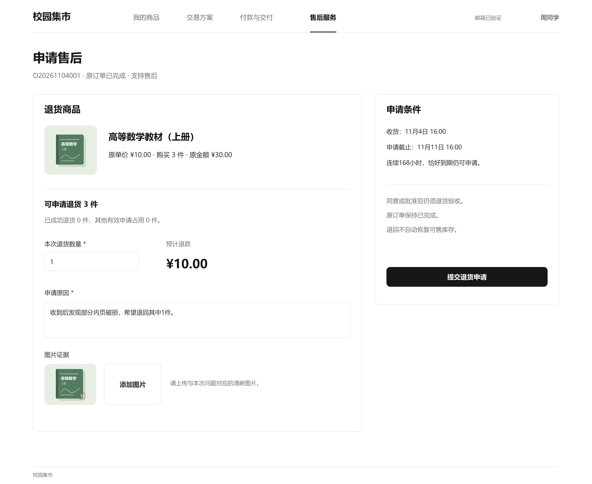

<!-- ui-page -->
### 平台管理模块 商品审核

管理员核对商品资料，决定通过或填写驳回原因；驳回后卖方可修改重提。平台管理还包括举报核查、账号限制、授权与代交分配、异常资金处理及统计日志，相关页面保留在过程稿，原交易历史持续保留。

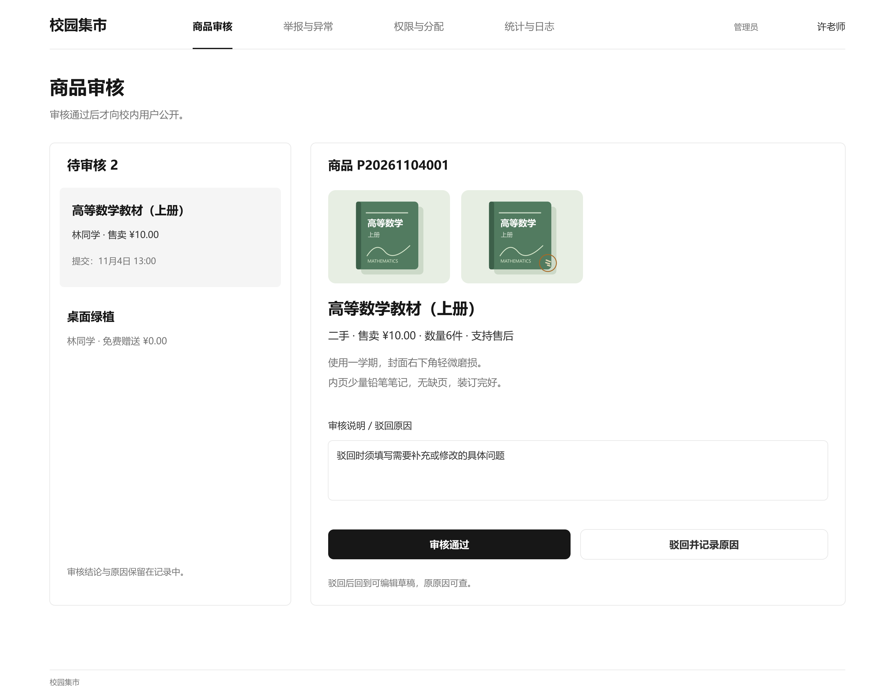

<!-- page-break -->
## 七 AI 辅助设计与改进

类图初稿包含34个领域类。我要求参照样例精简，并提出用户业务集合、举报目标、代交人员及售后参与人的关联，讨论后采用角色集合与平台统一管理，再用带成员名的关系线减少重复字段。AI 负责生成与改图，我负责判断职责、关系和业务约束。

组件图初稿突出了应用入口等技术结构，并合并了预约与订单、交付与售后。我认为应以业务模块为重点，因此要求分别拆分这些职责，将用户模块纳入主体，并把前端、数据库等放到外围。AI 据此调整为八个业务模块，职责与依赖更直观；图中省略的权限、日志和事务约束仍需核对。

状态图中，我指出售卖或赠送应在商品发布时确定，要求把它与付款、交付方案分开说明；同时提出补充独立的售后申请图，避免将退款进度混入已完成订单。AI 落实改图并精简图中文字，状态含义放在正文解释。

时序图中，我先要求精简说明，再尝试加入付款结果分支。比较后认为分支框影响阅读，最终选择三个主要阶段，异常规则放入文字。AI 能快速提供不同表达，但展示范围和清晰度仍需我判断。

UI初稿中，我要求缩小商品图，补充新旧和磨损说明，并将工作台分为买方预约与待确认、卖方待答复入口。随后要求改为白底黑字，精简商品卡片，同时保留彩色商品图。AI据此修订并补齐其他模块，我检查后要求报告不超过10张主要界面，其余图片另存。具体绘图、筛选与文件整理由AI执行，审查和信息取舍由我提出。

本轮UI由AI辅助生成SVG与PNG，并提供离线预览，尚未在Pixso内核对。静态画面有助于检查入口、信息和状态关系，但不能证明真实权限、并发或资金处理已实现。初稿、真实意见与主要修改均保留Git记录。

AI 能快速生成候选设计，但信息取舍仍需人工判断。后续按“明确需求—AI初稿—自动检查—人工核对—修改—Git留痕”推进，各次使用的场景、结果、优缺点及修改详情另存 AI 使用记录。
